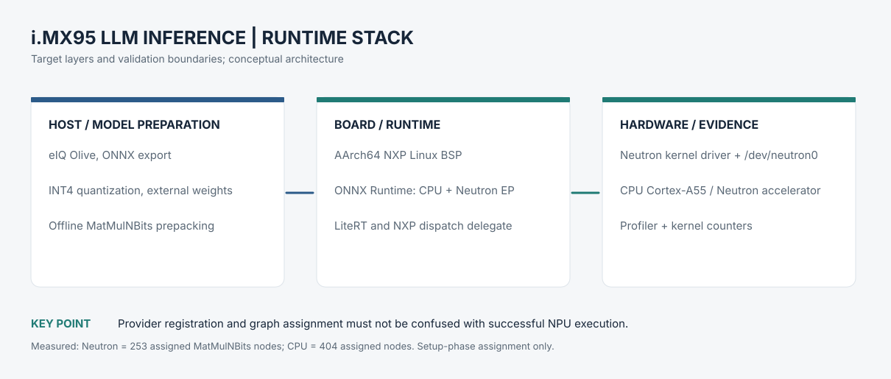

# Running and Investigating Local LLM Inference on NXP FRDM-i.MX95

**An evidence-backed embedded AI engineering research archive, November 2026**

This repository reconstructs a hands-on investigation into running large language models on the NXP FRDM-i.MX95 evaluation board, evaluating its Neutron NPU through the Linux BSP, LiteRT and ONNX Runtime, exploring low-bit ONNX model transformations, diagnosing allocation and graph-partition failures, and considering alternative GPU/Vulkan deployment paths.

It is an engineering notebook rather than a finished NPU deployment. Both successes and unsuccessful attempts are retained because they establish the practical boundary between **a recognized NPU, a provider accepting graph nodes, an initialized runtime session, and verified NPU execution**.



## Executive summary

| Investigation track | What was actually observed | What remains open |
|---|---|---|
| Linux bring-up | FRDM-i.MX95 booted NXP Linux, shell and hardware introspection worked | End-to-end reproducible BSP image and DTB hash |
| NPU access | `/dev/neutron0`, driver boot messages, and Neutron runtime libraries found | Full NPU performance-counter evidence during a successful LLM run |
| Memory | About 0.94 GiB CMA on an earlier configuration, about 4.94 GiB on a later one; runtime logged four 512 MB slots | Reliable large-model allocations and per-process memory accounting |
| LiteRT NPU path | NPU accelerator registered; quantized MobileNet example produced output, 5 runs averaging 116.480 ms | Per-op proof that the demonstrated classifier ran its intended workload on Neutron |
| ONNX Runtime unit test | Standard float MatMul returned `(1, 256)` while profiling attributed `MatMul_0_kernel_time` to **CPUExecutionProvider** | NPU-specific supported graph/weight path for a tiny test |
| Qwen3-4B ONNX | INT4-format ONNX graph explored; 253 `MatMulNBits` nodes assigned to **NeutronExecutionProvider** during graph setup | Successful matching session construction, execution and profiling |
| Large-model initialization | A `std::bad_alloc` NPU session failure was reported during investigation; separate captured verbose trace ended at tensor initialization | Reproduce allocation failure with a complete stderr trace and memory snapshot |
| Interactive language model | Qwen3-4B generated text on-device; measured 2.80 tokens/s on one application report | Attribute actual kernel execution to CPU vs. NPU and compare matched runs |
| Hybrid graph splitting | Two original Python variants recovered; split at layer 4 explored; ONNX checker and hard-link errors recorded | Correct graph export, independent validation, cache semantics, integrated execution |
| eIQ Olive | Qwen3-1.7B example recipe inspected, including SpinQuant and blockwise RTN passes | Successful Qwen custom export and deployable Neutron model from this investigation |
| Vulkan/llama.cpp | Host AArch64 Vulkan cross-compilation configured using sysroot and shader toolchain | Proven Vulkan LLM inference on the board |

**Critical conclusion:** ONNX Runtime assigning 253 nodes to Neutron is a meaningful deployment milestone, but **does not prove that those nodes ran successfully on the physical NPU**. Conversely, CPU fallback in an elementary MatMul test does not disprove Neutron support for a differently prepared INT4 model. The repository preserves both observations.

## Research questions

1. What works on the FRDM-i.MX95 without additional accelerators?
2. Can a local LLM generate usable text in the target Linux environment?
3. What is the difference between ONNX Runtime EP availability and actual NPU offload?
4. How are `MatMulNBits` weights quantized, arranged, and prepared for Neutron execution?
5. Which layers can be delegated to Neutron and which remain on CPU?
6. What prevents loading a multi-gigabyte Qwen model on Neutron despite adequate nominal RAM?
7. Can a hybrid prefix/suffix execution graph reduce the memory burden?
8. What alternatives exist through eIQ GenAI Flow, smaller models, and Vulkan?

## Target and observed environment

| Property | Board or observation |
|---|---|
| Board | NXP FRDM-IMX95 (`/proc/device-tree/model`) |
| Target OS | NXP i.MX Linux release distribution; at least two observed Linux/BSP states across sessions |
| Observed kernel | `6.18.37-2.1.0-g6e694eda40aa` in a later session |
| RAM | 7.5 GiB Linux-visible memory |
| NPU device | `/dev/neutron0`, device group `video` |
| Runtime providers | `NeutronExecutionProvider`, `CPUExecutionProvider` observed |
| Runtime versions | `1.22.0` in an earlier state and `1.24.3` in a later state; do not blend environments |
| Python | Python 3.14.5 in a later session; previous BSP tools also referenced Python 3.13 |
| Model artifact path | `/root/Qwen3-4B-ONNX-INT4/model.onnx` |
| Other investigated model | Qwen3-1.7B via NXP eIQ Olive recipe; NXP Danube-500M reference baseline |

These values describe historical snapshots and should not be interpreted as a single guaranteed boot configuration. See [hardware inventory](docs/02-board-bsp-and-cma.md).

## System software architecture

```text
Developer workstation (Linux host)
  |-- eIQ Olive / quantization recipe exploration
  |-- ONNX graph / model file inspection
  |-- Vulkan toolchain + sysroot cross-build experiment
  '-- archived code, logs and test plans
                |
          transferred files
                |
                v
NXP FRDM-i.MX95 (AArch64 Linux)
  |-- Linux DTB + Neutron kernel driver --> /dev/neutron0
  |-- NXP firmware and driver library --> libNeutronDriver.so
  |-- ONNX Runtime --> CPUExecutionProvider
  |             '--> NeutronExecutionProvider (MatMulNBits candidates)
  |-- LiteRT --> NXP Neutron dispatch delegate (independent path)
  '--> Qwen3-4B ONNX INT4 --> tokenizer / KV cache / generation loop
                                    |               |
                              CPU-only case    Neutron allocation experiments
```

The standard Neutron TFLite compiler pipeline and the **ONNX MatMulNBits offline prepacking path** are distinct. They are documented separately in [compiler and packing analysis](docs/06-neutron-prepacking.md).

## Architecture and evidence gallery

| Architecture | Actual captured evidence |
|---|---|
| [Runtime and device layers](assets/system-architecture.svg) | [Neutron ORT assignment report](assets/terminal-253-nodes.png) |
| [Experimental workflow](assets/research-workflow.svg) | [MatMul profiler CPU placement](assets/terminal-matmul-fallback.png) |
| [Hybrid graph splitting](assets/hybrid-model-split.svg) | [Hybrid split validation failure](assets/terminal-split-error.png) |
| [Actual static placement distribution](assets/onnx-placement.svg) | [Structured placement summary](results/ort_assignment_summary.json) |

The terminal images are **typeset visualizations of recorded text**, not photographs or original screenshots.

## Timeline of actual work

| Date | Track | Main action and result |
|---|---|---|
| Nov 9–10 | Board setup | Serial boot, NXP Linux shell, hardware and memory checks; investigated SolidRun i.MX8MP as an alternative |
| Nov 10 | GPU toolchain | AArch64 sysroot, shaderc/SPIRV-Headers, `llama.cpp` Vulkan configuration |
| Nov 10 | Runtime baseline | Observed Neutron EP available but a plain FP32 MatMul executed on CPU |
| Nov 11 | Driver verification | `neutron0` device and kernel logs; LiteRT dispatch initialization and MobileNet example |
| Nov 11 | Toolchain discovery | Examined `convert_ort_models_to_neutron.py`, driver interface and offline weight packing |
| Nov 11–12 | Qwen4B ONNX | Qwen3-4B ONNX INT4 model examination; 253 MatMulNBits nodes assigned to Neutron in verbose ORT trace |
| Nov 12 | Model export | Inspected NXP eIQ Olive Qwen3-1.7B SpinQuant/RTN model-building recipe |
| Nov 12 | Hybrid plan | Worked on separating first four transformer layers from remaining 32 and handling external weights |
| Nov 12 | Generated output | Qwen3-4B answered a user prompt and reported application-level token generation metrics |
| Nov 13 | Archive | Retrieved historical code and pastes; added evidence manifest and verification tooling |

The table separates observed work from proposals; detailed chronological context is in [timeline and decisions](docs/01-research-timeline.md).

## Interactive text-generation observation

One logged application sample reported:

```text
Input tokens: 21
Generated tokens: 128
Time to first token: 1.976 s
Prefill inference: 1.968 s
Total generation time: 47.310 s
Total NPU prefix time: 19.504 s
Total CPU suffix time: 26.632 s
Decode speed: 2.80 tokens/s
```

These are preserved as **application-reported measurements**, not an independent Neutron profiler. `NPU prefix time` is the application's name for a timed stage and must not be taken as proof that its operators ran on the NPU. Model, runtime settings and logs for the exact prompt run have not all been recovered. See [benchmarks](docs/11-performance-measurements.md).

## Repository layout

```text
README.md                   Executive overview and key measured findings
ARCHITECTURE.md             Diagram index and runtime layering
CHANGELOG.md                Archive reconstruction history
docs/                       Detailed engineering chapters (technical English)
experiments/                Experiment-by-experiment lab notebooks
src/archived/               Historical Python code, including two splitter revisions
src/experiments/            Clean diagnostic examples written for reproduction
scripts/                    Collection, inference inspection, profile and log parsers
results/                    Structured observations and analysis
evidence/terminal/          Sanitized historical terminal pastes
evidence/manifest.json      SHA-256 and provenance for each original paste
assets/                     Editable SVG diagrams and terminal visualizations
tests/                      Offline unit tests for research tools
references/                 External sources and licensing notes
```

## How to inspect this investigation

No board is required to review the historical evidence or run the log parser.

```bash
# Install Python tools only on a host venv. Do not replace the board's BSP ORT.
python3 -m venv .venv
source .venv/bin/activate
pip install -r requirements-analysis.txt

# Re-evaluate existing terminal placement observations (no NPU required).
python3 scripts/analyze_neutron_ort_log.py \
  evidence/terminal/20261112-113926-qwen-ort-verbose-253-neutron-nodes.log

# Inspect metrics and evidence integrity (standard library only).
python3 scripts/summarize_observations.py results/observations.csv
python3 scripts/verify_evidence_manifest.py
python3 -m unittest discover -s tests -v
```

On a compatible target, use read-only diagnostics first:

```bash
bash scripts/collect_board_information.sh
python3 scripts/check_onnxruntime_environment.py
python3 scripts/inspect_onnx_graph.py /root/Qwen3-4B-ONNX-INT4/model.onnx
```

The experimental split scripts are archival; they are **not** considered a validated inference engine:

```bash
python3 src/archived/split_qwen_hybrid_v2.py \
  --model /root/Qwen3-4B-ONNX-INT4/model.onnx \
  --out /root/Qwen3-4B-HYBRID \
  --layers 4
```

Only run the latter on a disposable output path after reviewing external-data behavior and the documented failures.

## What this repository does not claim

- No proven Qwen3-4B Neutron end-to-end inference or verified acceleration speedup.
- No proven successful execution of all 253 `MatMulNBits` nodes on hardware.
- No claim that the standard Neutron TFLite SDK compiled Qwen3-4B.
- No claim that the inspected offline ONNX prepack command was successfully completed.
- No claim that the hybrid ONNX halves passed validation or produced matching logits.
- No claim of GPU inference completion from the Vulkan cross-compilation configure log.
- No redistribution of Qwen weights, official model assets, NXP libraries, BSP images or proprietary compiler code.

## Principal outcomes and engineering lessons

The work demonstrated practical edge-LLM investigation across hardware, runtime and model-graph layers. It showed why accelerator enumeration, kernel placement and actual execution must be tested separately; why large CMA reservations do not automatically eliminate allocation problems; why ONNX external-data references and custom operators complicate manual graph partitioning; and why treating an NPU-specific offline conversion as interchangeable with a traditional compiler can lead to incorrect deployment assumptions.

The next meaningful milestone is a **fully initialized, instrumented Neutron session** for a small supported INT4 model, followed by a matched CPU/Neutron correctness and latency comparison, then incremental expansion toward Qwen3-4B.

## Documentation entry points

- [Research method and provenance](docs/00-research-method.md)
- [Chronology and decisions](docs/01-research-timeline.md)
- [Board, BSP and CMA](docs/02-board-bsp-and-cma.md)
- [Neutron software stack](docs/03-neutron-software-stack.md)
- [eIQ GenAI Flow](docs/04-eiq-genai-flow.md)
- [Qwen3 ONNX and INT4](docs/05-qwen3-int4-and-onnx.md)
- [Neutron Compiler versus ONNX weight prepacking](docs/06-neutron-prepacking.md)
- [ONNX Runtime profiling and the CPU fallback](docs/07-ort-provider-validation.md)
- [253-node assignment and memory failure](docs/08-qwen4b-session-initialization.md)
- [Four-layer hybrid split experiment](docs/09-hybrid-graph-partition.md)
- [eIQ Olive](docs/10-eiq-olive-model-optimization.md)
- [Performance analysis](docs/11-performance-measurements.md)
- [Vulkan and cross-compilation](docs/12-vulkan-llama-cpp.md)
- [Root cause investigation](docs/13-failure-analysis.md)
- [Follow-up research plan](docs/14-validation-roadmap.md)
- [Claim-to-evidence line index](docs/16-claim-to-evidence-ledger.md)
- [Model licensing and artifact policy](docs/17-model-artifacts-and-licensing.md)
- [External references](references/REFERENCES.md)

## Sources and credits

The archive builds on user-owned experimental work and observations. Reference implementations and documentation belong to their respective owners: NXP eIQ and eIQ Olive, ONNX Runtime, ONNX, Microsoft Olive, `llama.cpp`, and Hugging Face model authors. Links, version caveats and redistribution guidance are in [REFERENCES.md](references/REFERENCES.md).

**Status:** research archive and prototype diagnostics, not a production integration. **Evidence cutoff:** November 13, 2026.
